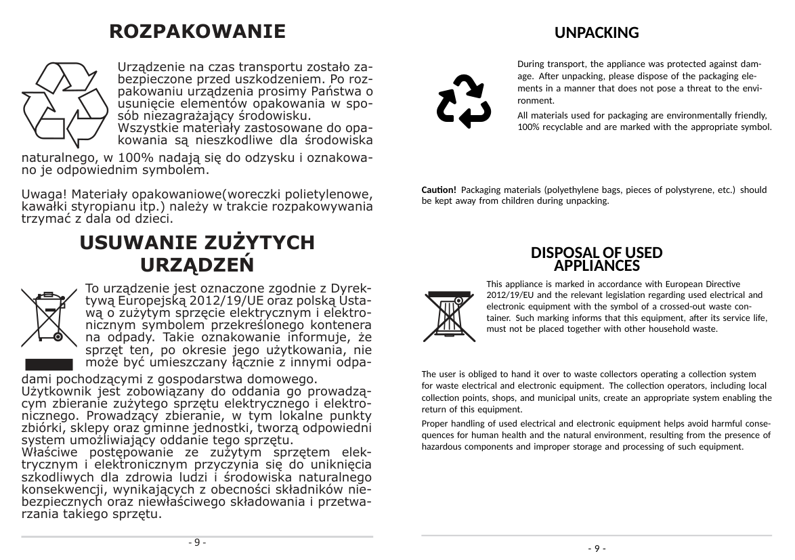
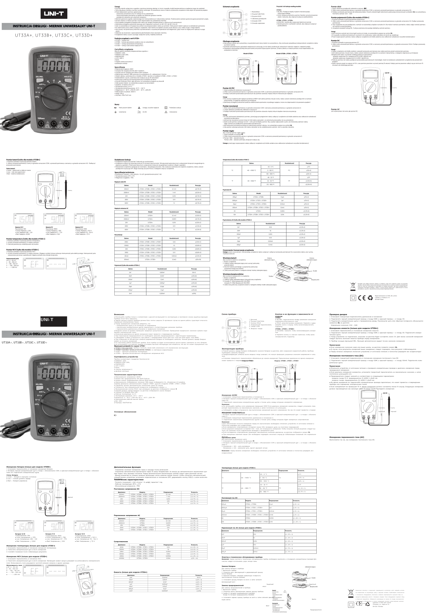

# manual2latex

**Turn PDF product manuals into editable, translatable LaTeX — page by page — using a LangGraph pipeline and vision models.**

Each page of a PDF manual is read (text layer + rendered image), recreated as LaTeX with the original layout, and **translated into your target language**. Photos and raster logos stay original; boxes, badges, icons, and drawings are rebuilt as LaTeX/TikZ. The per-page results are stitched into one clean PDF with bookmarks and metadata.

It works even on manuals with **no text layer** (outlined/vectorized text) — the model reads the page image directly.

## Results so far

| Manual | Run | Pages | Cost |
|---|---|---|---|
| UNI-T UT33 (no text layer) | PL → EN | 8 (1 fallback page) | $0.145 |
| UNI-T UT33 (no text layer) | PL → RU | 8 | $0.133 |
| AMICA oven manual p. 9 | PL → EN | 1, zero repairs | $0.0095 |

~$0.01–0.02 per page → a 326-page manual ≈ **$3–7**.

**AMICA p. 9 — original (left) vs. recreated + translated to English (right):**



**UNI-T — original Polish pages (top) vs. recreated Russian pages (bottom):**



## How it works

```
prepare ──► [Send × N pages] page worker ──► assemble
(font pick,    facts → assets → recreate →      stitch all page PDFs
 cached)        compile → repair ≤2 → fallback   → final PDF + report.json
```

- **Facts** — PyMuPDF extracts text lines (position, font, size, color) and shape boxes per page
- **Assets** — photos/logos are cropped from a *text-stripped* copy of the page, so translated text can be re-typeset on top
- **Recreate** — a vision model gets the page image + facts + assets and returns one `tikzpicture` page body in the target language
- **Compile** — 2-pass `lualatex`; on failure a cheaper repair model gets the log tail (escalating once); after two failed repairs the original page image stands in, so the output never breaks
- **Stitch** — final node merges per-page PDFs in order, adds per-page bookmarks + document metadata, and writes `report.json` with per-task token costs
- **Resume** — each finished page is recorded on disk; reruns only pay for new pages

## Quick start

Requirements: Python ≥ 3.11, a TeX Live 2026 user install (see
[`Documentation/Enviroment_instruction.md`](Documentation/Enviroment_instruction.md)),
an [OpenRouter](https://openrouter.ai) key.

```bash
python -m venv manual2latex/.venv && source manual2latex/.venv/bin/activate
pip install -r manual2latex/requirements.txt
echo 'OPENROUTER_API_KEY="sk-or-..."' > manual2latex/.env   # gitignored

cd manual2latex
python graph.py ../Examples/LXUT33.pdf --to ru --pages 1-8 --workers 4
```

Output: `out/<stem>.<lang>/<stem>.<lang>.pdf` (stitched), per-page `.tex/.pdf/.reply.md` in `pages/`, extracted assets in `pages/assets/`, cost summary in `report.json`.

### CLI

| Flag | Default | Meaning |
|---|---|---|
| `--to LANG` | `en` | target language code |
| `--pages A-B,c` | all | source page range(s), 1-based |
| `--out DIR` | `out/<stem>.<lang>` | output directory |
| `--workers N` | 4 | parallel page workers |
| `--dry-run` | off | no model calls — code-only skeleton pages, for testing mechanics |

## Model routing

One OpenRouter account; the model is chosen **per task** in `manual2latex/models.toml`:

| Task | Default | Escalates to |
|---|---|---|
| `recreate_page` (bulk) | `google/gemini-3.8-flash` | `anthropic/claude-sonnet-5.5` |
| `repair_latex` | `anthropic/claude-haiku-5.5` | `anthropic/claude-sonnet-5.5` |
| `choose_font` (once per doc) | `google/gemini-3.5-flash-lite` | — |

Change any line to taste; every call's tokens and cost land in `report.json`.

## Current limitations

This is a concept prototype. Not yet implemented: automatic language filtering for multilingual PDFs (pass `--pages` for the section you want), structured IR + validation, SSIM visual check, strings export for re-translation, human review gate. See the roadmap in
[`Documentation/Prototype.md`](Documentation/Prototype.md).

## Documentation

| File | Contents |
|---|---|
| [`Documentation/Prototype.md`](Documentation/Prototype.md) | what is implemented now, verified results, limitations |
| [`Documentation/Specification.md`](Documentation/Specification.md) | target architecture (IR schema, language map, review gate, translation hand-off) |
| [`Documentation/Example_corpus.md`](Documentation/Example_corpus.md) | the 11 test manuals in `Examples/`, measured properties, expected behavior per file |
| [`Documentation/Enviroment_instruction.md`](Documentation/Enviroment_instruction.md) | environment setup (venv, packages, TeX Live, API key) |
